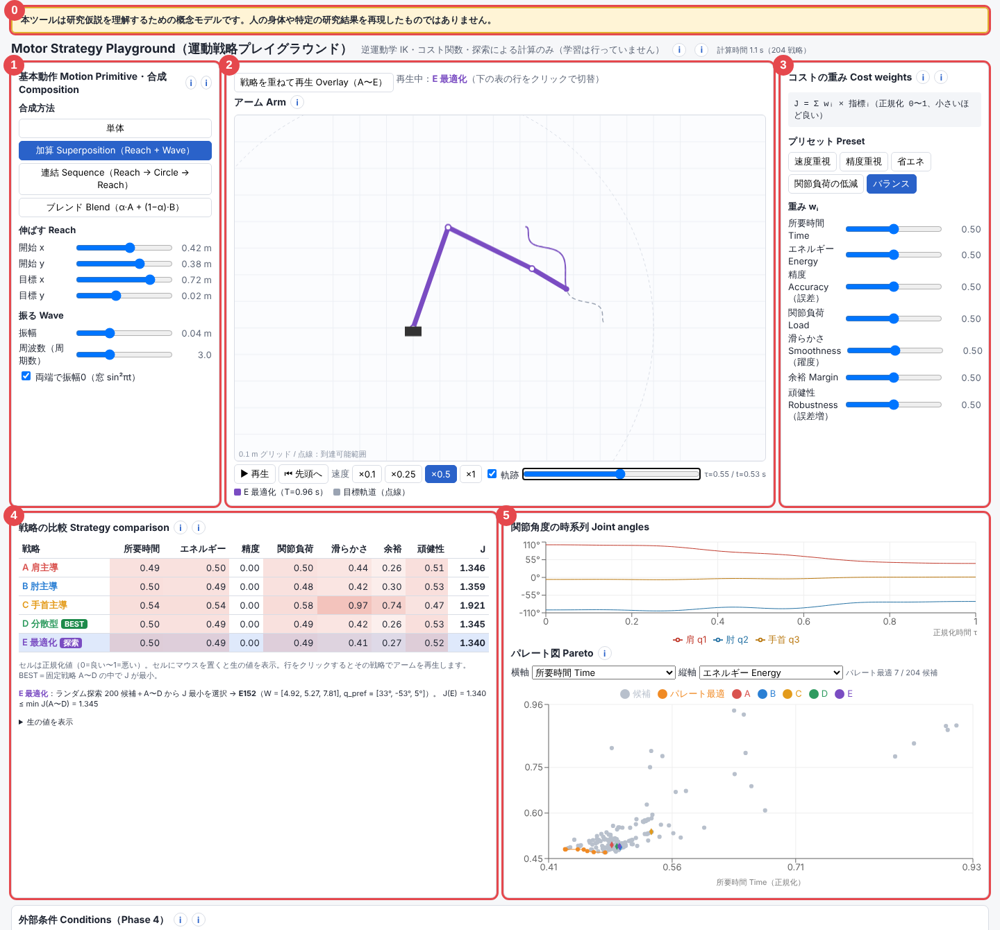
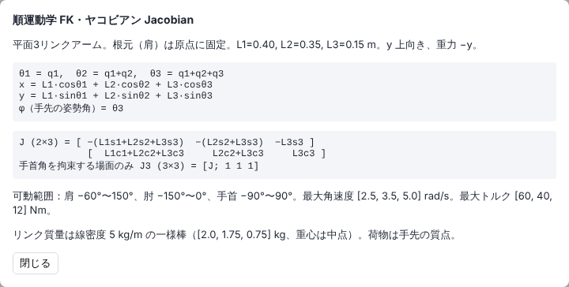
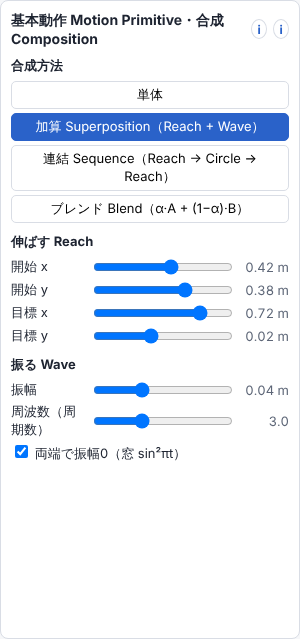
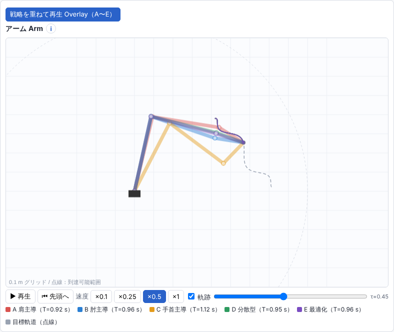
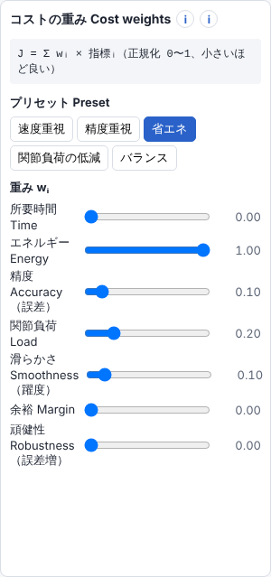
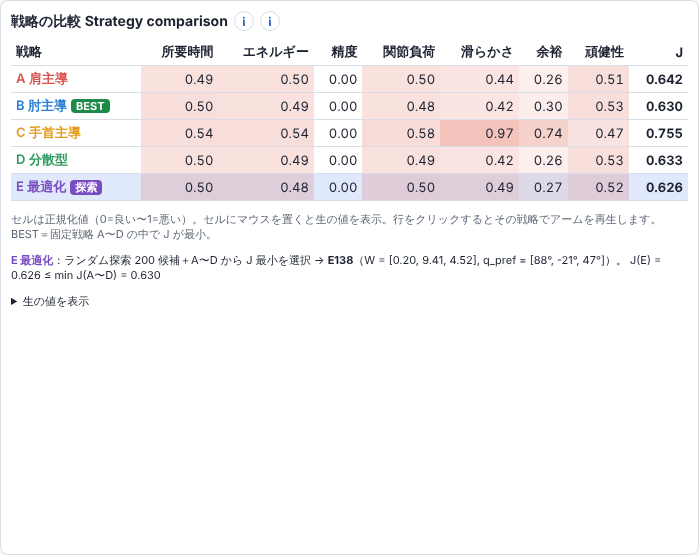
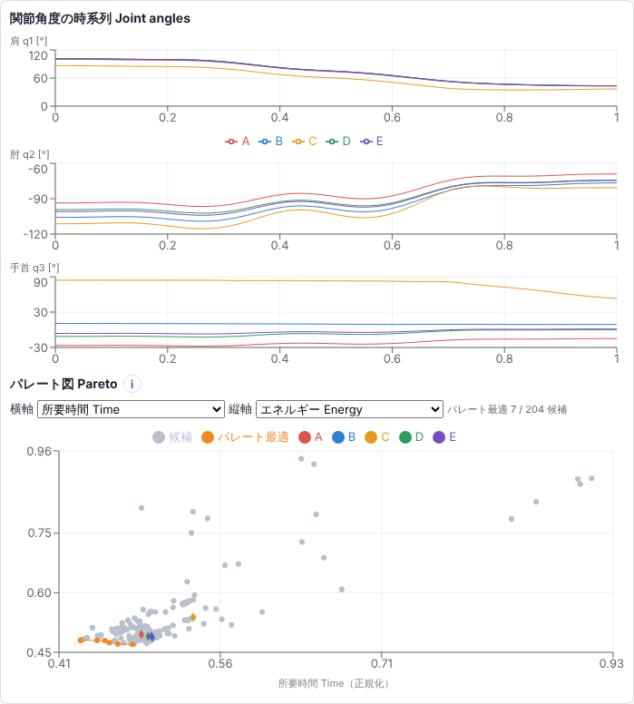
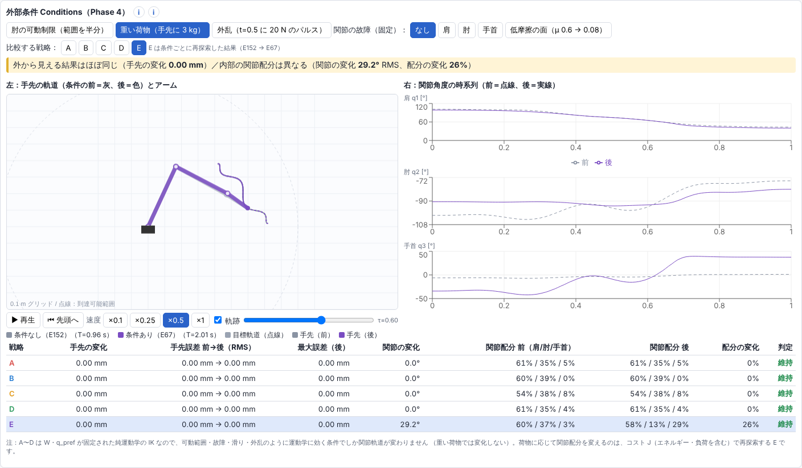
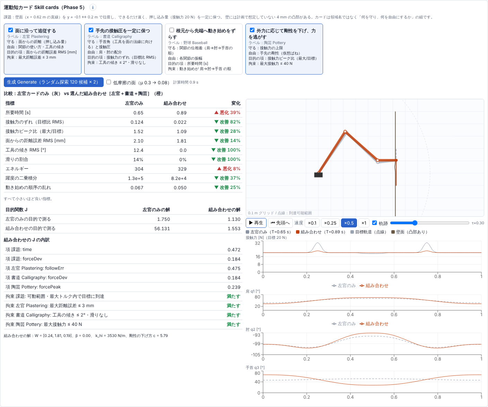

# Motor Strategy Playground 使い方ガイド

> **本ツールは研究仮説を理解するための概念モデルです。人の身体や特定の研究結果を再現したものではありません。**

はじめて使う人向けの説明書です。上から順に読めば、起動から5つの仮説の確かめ方まで一通りできるようになっています。
計算式の細かい話は画面の「i」ボタン、分かったことのまとめは [findings.md](findings.md) を見てください。

---

## 目次

1. [このツールは何をするもの？](#1-このツールは何をするもの)
2. [起動のしかた](#2-起動のしかた)
3. [まず5分で一周してみる](#3-まず5分で一周してみる)
4. [画面の見方](#4-画面の見方)
5. [各パネルの使い方](#5-各パネルの使い方)
6. [やってみよう：5つの仮説を確かめる](#6-やってみよう5つの仮説を確かめる)
7. [数字の読み方](#7-数字の読み方)
8. [警告が出たとき](#8-警告が出たとき)
9. [用語集](#9-用語集)
10. [よくある質問](#10-よくある質問)

---

## 1. このツールは何をするもの？

画面の中に、**根元が固定された3つの関節（肩・肘・手首）をもつ腕**があります。
この腕の **手先（指先）に「この線をなぞって」と指示** すると、ツールが各関節の角度を計算して腕を動かします。

ポイントは、**同じ線をなぞる腕の動かし方は1通りではない** ということです。
肩を大きく使う、手首をよく使う、といった「関節の使い分け」を **運動戦略（Strategy）** と呼びます。

このツールでは次のことを触って確かめられます。

| 確かめたいこと | 主に使う場所 |
| --- | --- |
| ① 簡単な動き（伸ばす・振る・円を描く…）を組み合わせると新しい動きになるか | 左パネル |
| ② 同じ手先の動きを、違う関節の使い方で実現できるか | 中央のアーム（重ねて再生） |
| ③ 「何を大事にするか」を変えると、選ばれる使い方が変わるか | 右パネルと比較表 |
| ④ 荷物や故障などの条件が変わっても、手先の結果は保てるか | 下段「外部条件」 |
| ⑤ 異なる分野の「コツ」を組み合わせると、新しい動きが生まれるか | 最下段「運動知カード」 |

> すべて計算（逆運動学・コスト関数・ランダム探索）によるもので、AI が学習した結果ではありません。

---

## 2. 起動のしかた

### 必要なもの
- **Node.js 18 以上**（https://nodejs.org/ から LTS 版をインストール）
- Chrome / Edge / Firefox / Safari などのブラウザ

### 手順

1. ターミナル（Mac は「ターミナル」、Windows は「PowerShell」）を開き、このフォルダに移動します。

   ```bash
   cd FT1
   ```

2. 初回だけ、必要な部品をインストールします（1〜2分かかります）。

   ```bash
   npm install
   ```

3. 起動します。

   ```bash
   npm run dev
   ```

4. 表示された URL（ふつうは **http://localhost:5173** ）をブラウザで開きます。

5. 終わるときは、ターミナルで `Ctrl + C` を押します。

> 起動直後や設定を変えた直後は、画面上部に「**計算中…**」と出ます。204 通りの動かし方を計算しているので、1〜3秒ほど待ってください。

---

## 3. まず5分で一周してみる

細かい説明の前に、次の順で触ってみるとツールの全体像がつかめます。

1. **開いたまま眺める**：中央で紫の腕が、点線（目標の線）をなぞって動いています。これが基本です。
2. **「戦略を重ねて再生」を押す**（中央パネル左上）：5色の腕が同時に動きます。**手先は同じ線を通るのに、腕の形が違う** ことを確認してください（仮説②）。
3. **右パネルのプリセットを順に押す**（速度重視 → 精度重視 → 省エネ → …）：下の比較表で緑の **BEST** バッジが付く行が入れ替わります（仮説③）。
4. **下段の「重い荷物」を押す**：数秒後、黄色い帯に「外から見える結果はほぼ同じ／内部の関節配分は異なる」と出ます（仮説④）。もう一度押すと解除されます。
5. **最下段の「生成 Generate」を押す**：「左官のみ」と「組み合わせ」の比較表が出て、良くなった指標が緑、悪くなった指標が赤で表示されます（仮説⑤）。

---

## 4. 画面の見方



| 番号 | 名前 | ひとことで言うと |
| --- | --- | --- |
| 0 | 注記 | 常に表示される注意書き（消えません） |
| 1 | 基本動作・合成（左パネル） | **手先にどんな線をなぞらせるか** を決める |
| 2 | アーム（中央） | 腕のアニメーション。どの戦略で動かすかは 4 の表で選ぶ |
| 3 | コストの重み（右パネル） | **何を大事にするか**（速さ・省エネ・正確さ…）を決める |
| 4 | 戦略の比較（中段左） | 戦略ごとの成績表。**行をクリックすると 2 の腕がその戦略に切り替わる** |
| 5 | 関節角度・パレート図（中段右） | 関節の角度の変化と、候補全体の散らばり |
| （下段） | 外部条件 | 荷物・故障などを加えて、前後を比べる |
| （最下段） | 運動知カード | 「コツ」のカードを組み合わせて新しい動きを作る |

**画面上部の小さな文字**：「計算中…」または「計算時間 1.1 s（204 戦略）」と出ます。計算中に表示されている数字は、ひとつ前の設定のものです。

**「i」ボタン**：各見出しの横にある丸い「i」を押すと、そこで使っている計算式が表示されます。閉じるには「閉じる」か、外側の暗い部分をクリックします。



---

## 5. 各パネルの使い方

### 5-1. 基本動作・合成（左パネル）



**① 合成方法を選ぶ**（上の4つのボタン）

| ボタン | 何が起きるか |
| --- | --- |
| 単体 | 基本動作を1つだけ使う。下に4つの動作ボタンが出る |
| 加算 Superposition | 「伸ばす」に「振る」を足す → **前進しながら手を振る** 動き（最初に表示される設定） |
| 連結 Sequence | 「伸ばす → 円を描く → 伸ばす」を順につなぐ |
| ブレンド Blend | 2つの動作を α : (1−α) の割合で混ぜる。A と B をプルダウンで選び、α をスライダーで変える |

**② 基本動作の種類**

| 動作 | 意味 | 主なパラメータ |
| --- | --- | --- |
| 伸ばす Reach | 開始点から目標点へまっすぐ動く（なめらかに加速・減速） | 開始 x/y、目標 x/y |
| 振る Wave | 波のように左右に揺れる | 振幅（揺れ幅）、周波数（揺れる回数） |
| 円を描く Circle | 円をなぞる | 中心 x/y、半径、周回数 |
| 押し付けて滑らせる Slide | 壁に押し付けながら壁に沿って動く | 面の位置・向き、開始/終了位置、押し込み量、往復 |

- 座標の単位はメートルです。腕の根元が (0, 0) で、x は右、y は上です。
- 腕の長さは合計 0.9 m です。アーム画面の **点線の円の外** には手先が届きません。
- スライダーを動かすと、0.2 秒後に自動で再計算されます。

### 5-2. アーム（中央）



| 操作 | 説明 |
| --- | --- |
| 戦略を重ねて再生 Overlay | オンにすると A〜E の5つの腕を半透明で重ねて描く。オフのときは表で選んだ1つだけ |
| ⏸ 一時停止 / ▶ 再生 | アニメーションの停止・再開 |
| ⏮ 先頭へ | 最初に戻る |
| 速度 ×0.1〜×1 | 再生速度（×1 が実際の速さ） |
| 軌跡 | 手先が通った線を表示するか |
| 横長のスライダー | 時刻を手で動かす（動かすと自動で一時停止） |
| τ= / t= | τ は 0〜1 の「進み具合」、t は実際の秒数 |

画面の見方：
- **灰色の点線** が目標の線、**色付きの線** が実際に手先が通った線です。
- 腕の白い丸は関節（根元側から肩・肘・手首）、先端の色付きの点が手先です。
- 下の凡例の **T=0.92 s** などは、その戦略でかかる時間です。
- Slide を選ぶと、茶色の線（壁）が表示されます。

### 5-3. コストの重み（右パネル）



「どんな動きが良いか」を数字で決めるパネルです。7つの評価項目に、それぞれ 0〜1 の重みを付けます。

- **プリセット** ボタンで、よく使う重みの組み合わせを一度に設定できます。今どれが選ばれているかは青で表示されます（スライダーを動かすと青が消えます）。
- **スライダー** で個別に調整できます。0 にすると、その項目は評価に使われません。

| 項目 | 小さいほど… |
| --- | --- |
| 所要時間 Time | 速く動ける |
| エネルギー Energy | 関節の力をあまり使わない |
| 精度 Accuracy | 手先が目標の線から外れない |
| 関節負荷 Load | 関節の力が上限に対して余裕がある |
| 滑らかさ Smoothness | 動きがカクカクしない |
| 余裕 Margin | 関節が曲がる限界から遠い |
| 頑健性 Robustness | 押されても手先がずれにくい |

> 重みを変えても再計算はせず、すでに計算済みの候補から選び直すだけなので、すぐに反映されます。

### 5-4. 戦略の比較（中段左）



**行 = 戦略** です。行をクリックすると、中央の腕がその戦略で動きます（選択中の行は青く表示されます）。

| 戦略 | 考え方 |
| --- | --- |
| A 肩主導 | 肩を動かしやすく、肘・手首を動かしにくく設定 |
| B 肘主導 | 肘を動かしやすく設定 |
| C 手首主導 | 手首を動かしやすく設定 |
| D 分散型 | どの関節も同じくらい動かしやすく設定 |
| E 最適化 | 200 通りの設定をランダムに試し、いまの重みで一番成績の良いもの |

- **セルの数字**：0（良い）〜 1（悪い）にそろえた値です。赤が濃いほど悪いです。
- **セルにマウスを置く** と、生の値（秒、ミリメートルなど）が表示されます。表の下の「▶ 生の値を表示」を押すと一覧でも見られます。
- **J**：右パネルの重みで計算した総合点です。**小さいほど良い** です。
- **BEST**（緑）：A〜D の中で J が一番小さい戦略。
- **探索**（紫）：E は探索で選んだ結果という印。表の下に、E がどの候補を選んだかと、「J(E) ≤ A〜D の最小」になっていることが書かれています。
- **⚠**：その戦略で警告が出ています。マウスを置くと内容が出ます。

### 5-5. 関節角度・パレート図（中段右）



**関節角度の時系列**：横軸が進み具合（0〜1）、縦軸が角度（度）です。
- 通常は、選んだ戦略の肩・肘・手首の3本が1つのグラフに表示されます。
- 「戦略を重ねて再生」をオンにすると、関節ごとの3つのグラフに A〜E が重ねて表示されます。**線がずれているほど、関節の使い方が違う** ということです。

**パレート図**：2つの評価項目を選んで、204 個の候補を点で並べた図です。
- 横軸・縦軸のプルダウンで項目を選びます。どちらも **左下ほど良い** です。
- **オレンジの点と線**：「パレート最適」＝どちらの項目でも他の候補に負けていない候補。片方を良くするともう片方が悪くなる、という **トレードオフの境目** です。
- ひし形の色付きの点が A〜E です。

---

## 6. やってみよう：5つの仮説を確かめる

### 仮説① 基本動作を合成すると、新しい動作が作れるか

1. 左パネルで「**加算 Superposition**」を選ぶ（最初からこの状態です）。
2. 「振る Wave」の **振幅** を 0 にすると、ただまっすぐ伸ばす動きになります。少しずつ大きくすると、**前進しながら揺れる** 動きに変わります。
3. 「**連結 Sequence**」を押すと、伸ばす → 円 → 伸ばす がつながった動きになります。つなぎ目で手先が **いったん止まってから** 次の動きに入ることを観察してください（速度は途切れずにつながっています）。
4. 「**ブレンド Blend**」で A＝円、B＝伸ばす にして α を動かすと、円と直線の中間の形が作れます。

**見るところ**：アームの点線（目標）と色の線（実際）が重なっていれば、合成した動きを腕が実現できています。

### 仮説② 同じ手先の結果を、違う関節の使い方で実現できるか

1. 中央の「**戦略を重ねて再生**」を押す。
2. 速度を **×0.25** にしてゆっくり見ると、**手先はほぼ同じ所を通るのに、肘や手首の位置が違う** のが分かります。
3. 中段右の関節角度のグラフで、A〜E の線がずれていることを確認します。

**見るところ**：比較表の「精度」がどの戦略も 0.00 付近（＝手先は目標どおり）なのに、関節のグラフは違う、という組み合わせです。

> 気づきのヒント：A・B・D は思ったより似ています。この腕は「手先の位置」だけを指定すると、自由に選べる余地が1つ分しかないためです（詳しくは [findings.md](findings.md)）。

### 仮説③ 重みを変えると、選ばれる戦略が変わるか

1. 右パネルのプリセットを **速度重視 → 精度重視 → 省エネ → 関節負荷の低減 → バランス** の順に押す。
2. そのたびに比較表の **BEST バッジ** がどの行に付くかを見る。最初の設定では A → A → B → A → D と入れ替わります。
3. E の行の下の説明文で、E が選ぶ候補（W や q_pref の値）も変わることを確認します。
4. パレート図の軸を「所要時間」と「エネルギー」にすると、速さと省エネのトレードオフが見えます。

**見るところ**：BEST が入れ替わるか。また、J の差がどのくらい小さいか（差が小さいと、少しの重みの違いで結果が変わります）。

### 仮説④ 条件が変わっても、手先の結果は保てるか



1. 下段「**外部条件**」のボタンを1つ押す（例：**重い荷物**）。数秒待つと比較が表示されます。
2. **黄色い帯** に「外から見える結果はほぼ同じ（手先の変化 ○ mm）／内部の関節配分は異なる（関節の変化 ○°、配分の変化 ○%）」と出ます。
3. **左の図**：灰色（条件なし）と色付き（条件あり）の腕と手先の線を重ねています。手先の線は重なり、腕の形は違います。
4. **右のグラフ**：点線が条件なし、実線が条件ありの関節角度です。ずれが内部の変化です。
5. 「比較する戦略」の A〜E ボタン、または下の表の行で、比べる戦略を切り替えられます。
6. 下の表の「判定」列で、全戦略について **維持 / 維持できない** が一覧できます。

条件の種類：

| ボタン | 内容 | 試すと分かること |
| --- | --- | --- |
| 肘の可動制限 | 肘の曲がる範囲を半分にする | 肘を大きく使う戦略が影響を受ける |
| 重い荷物 | 手先に 3 kg の荷物 | A〜D は変わらず、E だけ使い方を変える |
| 外乱 | 途中で手先を 20 N で押す | 一瞬ずれて、元に戻る |
| 関節の故障 | 選んだ関節をほぼ固定（なし／肩／肘／手首） | 手首なら他が肩代わりできる。**肩だと維持できない** |
| 低摩擦の面 | 壁が滑りやすくなる | **Slide を含む動作のときだけ** 効果あり（左パネルで「単体」→「押し付けて滑らせる」） |

条件は複数同時にオンにできます。もう一度押すとオフになります。条件がオンの間は、中段の表・アーム・グラフも条件下の結果になります（中央パネルの上に「条件適用中」と出ます）。

**維持できないとき**は、帯が赤くなり理由が表示されます。


### 仮説⑤ 異なる分野の「コツ」を組み合わせると、新しい動きが生まれるか



この部分だけは、上の設定とは別の **決まった課題** を使います。

> **課題**：壁に道具を押し付けながら上下に往復する。できるだけ速く、押す力（20 N）を一定に保つ。壁には計画では想定していない小さな出っ張り（4 mm）がある。

1. **カードをクリック** して選ぶ（チェックが付き、青くなります）。もう一度クリックで外れます。

   | カード | 守るもの | 自由にするもの |
   | --- | --- | --- |
   | 面に沿って追従する（左官） | 壁からの距離 | 関節の使い方・道具の傾き |
   | 手先の接触圧を一定に保つ（書道） | 道具を壁にまっすぐ向ける・押す力 | 肩と肘の配分 |
   | 根元から先端へ動き始めをずらす（野球） | 肩→肘→手首の順に動き始める | 各関節の動く量 |
   | 外力に応じて剛性を下げ、力を逃がす（陶芸） | 押す力の上限 | 手先の硬さ |

   分野の名前はラベルにすぎません。中身は「何を守り、何を自由にするか」の組です。

2. 必要なら「**低摩擦の面**」にチェックを入れる（壁が滑りやすくなります）。
3. 「**生成 Generate**」を押す。1秒ほどで結果が出ます。
4. 結果の見方：
   - **比較表**：「左官のみ」と「組み合わせ」の指標を並べ、右端に **▼ 改善（緑）／▲ 悪化（赤）／≈ 同じ** を表示します。
   - **目的関数 J の表**：両方の解を、両方の物差しで測った点数です。
   - **J の内訳**：組み合わせの点数が、どの項目からできているか。拘束（守るべき条件）を満たせたかも表示されます。
   - **右の図**：灰色が左官のみ、オレンジが組み合わせの腕。下に押す力のグラフと関節角度のグラフがあります。

**試してみると面白い組み合わせ**：
- 左官＋書道：滑りはなくなるが、時間がかかる
- 左官＋陶芸：出っ張りでの力の山が小さくなる
- 左官＋野球：順番は守れるが、かえって遅くなる
- 4枚すべて：書道と野球の拘束がぶつかり、野球の拘束を満たせない

> カードを変えたら、もう一度「生成」を押してください（自動では再計算されません）。

---

## 7. 数字の読み方

| 表示 | 意味 |
| --- | --- |
| 0〜1 の数字（比較表） | 項目ごとにそろえた点数。**0 に近いほど良い**。真ん中の候補がおよそ 0.5 になるように調整している |
| J | 重み × 点数 の合計。**小さいほど良い** |
| BEST | A〜D の中で J が最小 |
| E | 200 候補＋A〜D から J が最小のもの。必ず BEST 以下になる |
| τ（タウ） | 動きの進み具合（0 = 開始、1 = 終了） |
| T | その戦略で動き終えるまでの時間（秒）。関節の速さの上限から計算 |
| 関節配分（肩/肘/手首） | 手先の動きのうち、各関節がどれだけ担ったかの割合 |
| 配分の変化 | 条件の前後で関節配分がどれだけ変わったか（0〜100%） |
| 手先の変化 | 条件の前後で手先の通った線がどれだけずれたか（mm） |
| 関節の変化 | 条件の前後で関節角度がどれだけ違うか（度） |

---

## 8. 警告が出たとき

このツールは、無理な結果を **こっそり直さずに警告として表示** します。警告が出ても故障ではありません。

| 警告 | 意味 | 対処の例 |
| --- | --- | --- |
| ⚠ 目標点が到達可能範囲の外にあります | 腕が届かない所を指定している | 開始点・目標点・円の中心を、点線の円の内側に動かす |
| ⚠ ○○の可動範囲を超えています | 関節が曲がる限界を超えている | 別の戦略を選ぶ／目標を近くにする |
| ⚠ 手先が目標に到達できない区間があります | 線をなぞりきれていない | 届く範囲に収める／故障条件を外す |
| △ ○○のトルクが最大値を超えます | 関節の力が足りない | 荷物を外す／ゆっくりした動きにする |
| △ 滑りが生じる区間があります | 壁に対して道具が傾きすぎ | 情報として表示しています |
| △ 手首角を摩擦円錐内に拘束して再計算 | 滑らないように手首の向きを自動で制限した | 情報として表示しています |
| △ 低摩擦の面は Slide を含む動作でのみ効果があります | 壁がない動作では意味がない | 左パネルで「単体」→「押し付けて滑らせる」を選ぶ |

---

## 9. 用語集

| 用語 | 説明 |
| --- | --- |
| 手先 | 腕の先端。ここに目標の線をなぞらせる |
| 基本動作（Motion Primitive） | 伸ばす・振る・円・押し付けて滑らせる、の4つの単純な動き |
| 合成（Composition） | 基本動作を足す・つなぐ・混ぜること |
| 運動戦略（Strategy） | 同じ手先の動きを実現する、関節の使い分け方 |
| 冗長性 | 同じ手先の位置を、何通りもの関節角度で実現できること |
| 逆運動学（IK） | 手先の位置から関節の角度を計算する方法 |
| W（動かしにくさ） | 関節ごとの重み。大きい関節ほど動かさないように計算される |
| q_pref（好みの姿勢） | 手先を変えない範囲で、近づこうとする関節角度 |
| コスト（J） | 動きの「悪さ」を1つの数にまとめたもの |
| パレート最適 | どの項目でも他に負けていない候補。トレードオフの境目 |
| 外乱 | 動作中に外から加わる力 |
| 摩擦円錐 | 道具がこの角度以上傾くと滑る、という範囲 |
| 剛性 | 硬さ。低いと押されたときにへこみやすい（力を逃がせる） |

---

## 10. よくある質問

**Q. 画面が「計算中…」のまま変わりません。**
A. 条件をオンにしている場合は 2〜3 秒かかります。10 秒以上変わらないときは、ブラウザを再読み込み（F5 / Cmd+R）してください。

**Q. 同じ設定なのに結果が変わることはありますか？**
A. ありません。乱数は固定しているので、同じ設定なら必ず同じ結果になります。

**Q. 設定を最初の状態に戻したい。**
A. ブラウザを再読み込みしてください（設定は保存されません）。

**Q. 腕が変な形になったり、急に回ったりします。**
A. 目標が届かない、または関節の限界を超えているときに起きます。警告欄を確認してください。届かない目標に対しても、補正せずにそのまま追いかけようとするためです。

**Q. A・B・D の違いが小さいのはバグですか？**
A. バグではありません。平面の3関節の腕では、手先の位置を決めると自由に選べる余地が1つ分しかないためです。これ自体がこのツールで分かったことの1つです（[findings.md](findings.md)）。

**Q. 「重い荷物」で A〜D が変わらないのはなぜ？**
A. A〜D は腕の形だけで動きを決めていて、重さを考えないためです。重さに応じて使い方を変えるのは、エネルギーや関節負荷を評価して選び直す E だけです。

**Q. 「低摩擦の面」を押しても何も変わりません。**
A. 壁がある動作（押し付けて滑らせる Slide）でのみ効果があります。左パネルで「単体」→「押し付けて滑らせる Slide」を選んでから試してください。

**Q. 計算式を確認したい。**
A. 各見出しの横の「i」ボタンを押してください。プログラムの中では `src/ui/formulas.ts` にまとまっています。
